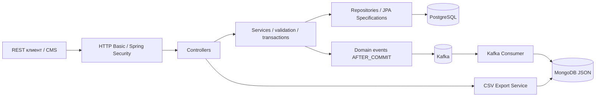
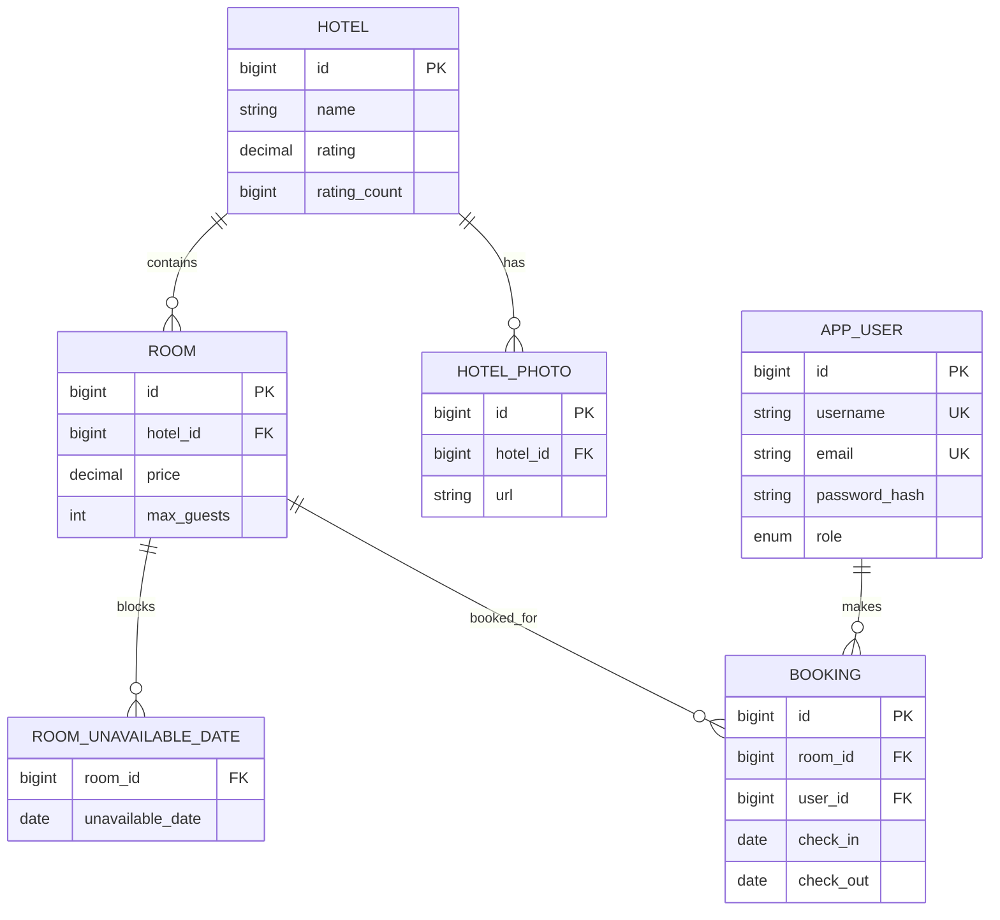
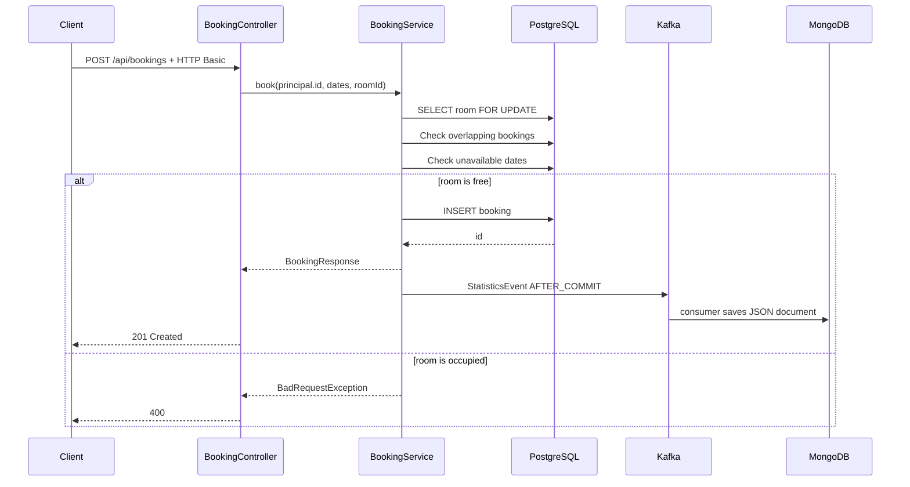

# Архитектура Hotel Booking

## Компоненты

## Основная модель

## Сценарий бронирования

Полуоткрытая модель периодов позволяет заезжать в день предыдущего выезда. `room_unavailable_dates` хранит отдельные даты, а `bookings` — интервалы, обе формы занятости учитываются в JPA Specification.

## Границы ответственности

- Controller не содержит бизнес-логики: авторизация/валидация запроса, вызов сервиса, HTTP-код.
- Service управляет транзакциями, проверками и инвариантами.
- Repository предоставляет CRUD, запросы пересечений и пессимистические блокировки.
- MapStruct переводит DTO в сущность и обратно, не предоставляя клиенту `passwordHash` или возможности напрямую править рейтинг.
- Flyway создаёт первичную схему, Hibernate только проверяет (`ddl-auto=validate`).
- Kafka и Mongo не находятся в критическом пути SQL-транзакции.
